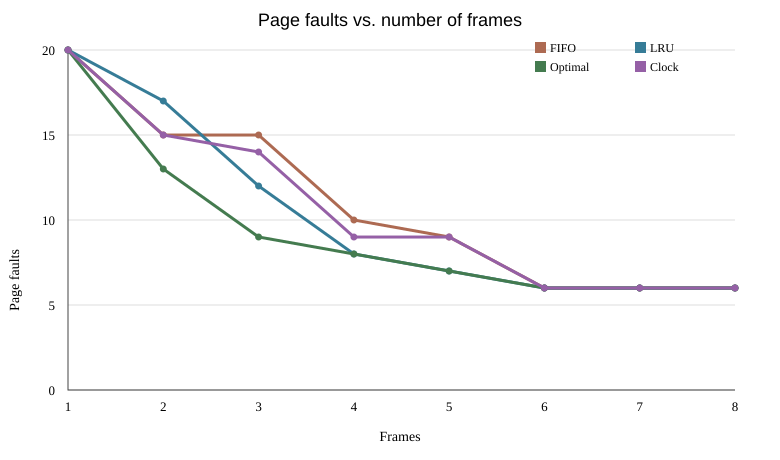

# Практическая работа №11: Алгоритмы замещения страниц

**Варианты:** A, B и C (все уровни)  
**Репозиторий:** [ibrodevs/OS-P-11](https://github.com/ibrodevs/OS-P-11.git)  
**Студент:** Иброхим Абдраимов (`ibrodevs`)  
**Группа:** CS-32-24

---

## Цель работы

Реализовать алгоритмы замещения страниц **FIFO, LRU, Optimal и Clock**, сравнить их по количеству страничных отказов, воспроизвести **аномалию Белади**, изучить локальность обращений и измерить реальные `minor/major page faults` в Linux.

## Обоснование выбора окружения

Варианты A и B написаны на **Python 3** и не требуют ОС Linux для самой симуляции. Вариант C реализован на **C (C11)** и предназначен для Linux, поскольку использует `getrusage(2)`, `/proc/self/stat`, `mmap(2)` и подсистему cgroup v2. При подготовке проверены Linux x86_64 (ядро 6.18.57), Python 3.13.5 и GCC 14.2.0. Значения низкоуровневых измерений зависят от компьютера, окружения и кеширования.

---

## Структура репозитория

```text
OS-P-11/
├── README.md                  # Отчёт в стиле OS-P-1
├── FULL_REPORT.md             # Подробное объяснение уровней A, B, C
├── replace.py                 # FIFO / LRU / Optimal / Clock и трассировка
├── experiments.py             # CSV и график; два вида локальности
├── requirements.txt           # matplotlib
├── tests/test_replace.py      # 13 тестов симулятора и независимый оракул Optimal
├── tests/test_c_integration.py # 2 проверки реальной C-программы (Linux)
├── c/
│   ├── Makefile
│   ├── page_faults.c           # getrusage и /proc/self/stat, anon/file mmap
│   └── matrix_bench.c          # Обход матрицы по строкам и столбцам
├── scripts/
│   ├── run_c_experiments.sh    # Безопасные небольшие эксперименты
│   └── pressure_demo.sh        # Отдельная cgroup для демонстрации давления
├── assets/page_faults.svg     # Кривые 1–8 кадров
└── results/                   # Вычисленные CSV и пример измерений Linux
```

---

## Инструкция по запуску и проверке

```bash
git clone https://github.com/ibrodevs/OS-P-11.git
cd OS-P-11
python3 replace.py
python3 replace.py --refs belady --frames 3 4 --trace
python3 -m unittest discover -s tests -v
python3 -m pip install -r requirements.txt
python3 experiments.py
```

Для Linux и компилятора C:

```bash
make -C c
./scripts/run_c_experiments.sh
# Опционально: только на отдельном Linux с user-systemd/cgroup v2,
# реальная проверка memory pressure, без изменения глобальных лимитов:
./scripts/pressure_demo.sh
```

**Проверка после клонирования:** оба shell-скрипта сохранены в Git с правами `100755`, чтобы команды `./scripts/...` запускались без `chmod`. Новые тесты дополнительно проверяют, что C-режим `local` действительно использует и горячие, и холодные страницы, а режим `file` обрабатывает ненулевые контрольные данные.

**Важно:** `ulimit -v` ограничивает виртуальное адресное пространство, а не количество физических кадров; одного `ulimit` недостаточно для демонстрации пробуксовки. `pressure_demo.sh` может не работать, если недоступен пользовательский systemd, и не гарантирует рост major faults без реально вытесняемых файловых страниц. Не запускайте стресс-тест на рабочем сервере.

---

## Выполнение задания

### Вариант A — FIFO, LRU, Optimal

Алгоритмы реализованы в `replace.py`. **Попадание** не увеличивает счётчик отказов. LRU обновляет последнее время обращения **на каждом доступе**, Optimal смотрит **в будущее** контрольной строки.

**Контрольная строка Silberschatz:** `7 0 1 2 0 3 0 4 2 3 0 3 2 1 2 0 1 7 0 1`.

| Алгоритм | 3 кадра | 4 кадра |
|---|---:|---:|
| FIFO | **15** | 10 |
| LRU | **12** | 8 |
| Optimal | **9** | 8 |
| Clock | **14** | 9 |

Эталоны для FIFO/LRU/Optimal при трёх кадрах совпали. **Optimal** обеспечивает минимальное число отказов для известной последовательности, но непригоден как реально исполняемый онлайн-алгоритм: ОС не знает будущие обращения.

### Вариант B — Clock, график, Белади, локальность

Clock хранит `frames`, биты обращения `bits` и циклическую стрелку `hand`. При попадании выставляет бит в `1`; при промахе сбрасывает встретившиеся `1` в `0`, пропускает эти страницы и заменяет первую страницу с битом `0` (или свободный кадр). В контроле Clock получил **14 отказов** при 3 кадрах.



**Аномалия Белади:** строка `1 2 3 4 1 2 5 1 2 3 4 5`.

| Алгоритм | 3 кадра | 4 кадра |
|---|---:|---:|
| FIFO | **9** | **10** |
| LRU | 10 | 8 |
| Optimal | 7 | 6 |
| Clock | 9 | 10 |

При добавлении кадра FIFO неожиданно увеличил число отказов с 9 до 10. LRU и Optimal обладают **свойством стека** (при большем числе кадров множество страниц включает набор меньшего числа кадров), поэтому аномалия Белади у них невозможна. Clock, как и FIFO, свойства стека не гарантирует.

**Сравнение локальности:** `experiments.py` создаёт 2000 обращений к страницам 0–19, с фиксированным seed=42. Первый набор: 85% обращений к страницам 0–3, остальные 15% к 4–19. Второй набор: равномерный случайный выбор из 0–19.

| Паттерн / 4 кадра | FIFO | LRU | Optimal | Clock |
|---|---:|---:|---:|---:|
| Локальность (85% к 4 страницам) | 806 | 692 | 419 | 771 |
| Случайные обращения (20 страниц) | 1591 | 1583 | 1116 | 1586 |

При наличии локальности LRU сохраняет горячее множество и намного чаще попадает. При равномерном доступе к 20 страницам при 4 кадрах промахов намного больше. Дополнительные значения для 3 и 8 кадров — `results/locality.csv`.

### Вариант C — реальные отказы в Linux

В `c/page_faults.c` два источника счётчиков: `getrusage(RUSAGE_SELF)` и поля **10 (`minflt`) / 12 (`majflt`)** файла `/proc/self/stat`. Поля извлекаются корректно даже при пробелах в имени процесса. При анонимном `mmap` запись в новую страницу обычно вызывает **minor fault**, но не обязательно major fault. Для анализа файлового I/O есть режим `--mode file` с временным файлом и `mmap`.

Измерено в тестовом Linux (32 МиБ; вывод каждого запуска лежит в `results/c_*.csv`):

| Эксперимент, первый проход | Minor (`getrusage`) | Major (`getrusage`) |
|---|---:|---:|
| Anonymous / sequential | 8212 | 0 |
| File / sequential | 449 | 1 |
| File / random | 524 | 6 |
| File / local | 129 | 1 |

Это **реальные измерения указанного окружения после исправлений**, а не гарантированный эталон. В `file` режиме первая ячейка каждой страницы содержит определённое ненулевое значение; поэтому контрольная сумма проверяема. В режиме `local` девять из десяти обращений приходятся на горячую восьмую часть страниц, каждое десятое — на холодную. Сами величины `minor` и `major` зависят от окружения. Разница между `getrusage` и `/proc` может возникать из-за последовательности измерительных вызовов и их собственных обращений к памяти. Измерения без swap или без вытеснения файла могут показывать **0 major faults**, даже при большом числе minor faults.

**Обход матрицы** 2048×2048, три повтора (одни и те же элементы в памяти, компиляция `-O2`):

| Порядок обхода | Время, секунды | Контрольная сумма |
|---|---:|---:|
| По строкам | 0.004413 | 792723081 |
| По столбцам | 0.067426 | 792723081 |

В данном запуске по столбцам — примерно **15.3 раза медленнее**. В C массив хранится в порядке строк, поэтому построчный проход лучше использует соседние элементы кэш-линий и страниц. При других CPU, размерах массива и оптимизациях числа изменятся.

**Пробуксовка:** код и изолированный сценарий сравнения `192 MiB working set` без ограничения и с cgroup `MemoryMax=96M` готовы в `scripts/pressure_demo.sh`. В текущей среде **нет активной пользовательской шины systemd** для постановки отдельного лимита, поэтому результаты cgroup не выдаются за реально полученные; сценарий нужно запускать на подходящем Linux и проверить по CSV изменение major faults и времени. Рост не гарантирован на файловой системе с необычным кешированием.

---

## Контрольные вопросы

**1. Почему LRU не подвержен аномалии Белади, а FIFO подвержен?** LRU — стековый алгоритм: при N+1 кадрах сохранённые страницы включают страницы при N кадрах. FIFO следит только за временем загрузки, а не актуальностью страницы; порядок выгрузки для разных размеров памяти может существенно измениться. Поэтому дополнительные кадры иногда приводят к лишним промахам.

**2. Чем major page fault отличается от minor?** `minor` разрешается без чтения страницы из внешнего хранилища (например, выделение zero-filled страницы или готовая страница в page cache). `major` требует операции ввода с диска или swap и обычно дороже. `major` не означает всякий промах виртуального адреса, а `minor` не означает попадание симуляции.

---

## Ключевые результаты и вывод

- Все три эталона контрольной строки **15 / 12 / 9** подтверждены тестами, Clock — **14**.
- График построен для **1–8 кадров**, CSV сохранены.
- FIFO: аномалия Белади воспроизведена и объяснена: **9 → 10**.
- Локальность резко уменьшает число отказов, особенно для LRU.
- Данные Linux C измерены через два интерфейса; продемонстрирована разница minor и major.
- Сравнение режимов `local` и `random` поддерживается проверяемыми контрольными суммами, а локальность использует **две** разные области страниц.
- Разница между обходом матрицы по строкам/столбцам подтверждена экспериментом.
- Пределы воспроизводимости реальной пробуксовки указаны без выдуманных измерений.

**Вывод:** число страничных отказов определяется политикой вытеснения и локальностью обращений. Optimal даёт теоретическую нижнюю границу, LRU учитывает актуальность обращений, Clock приближает LRU с небольшими затратами, FIFO прост, но подвержен аномалии Белади. Результаты учебного симулятора и счётчики ядра Linux измеряют разные уровни работы памяти.
